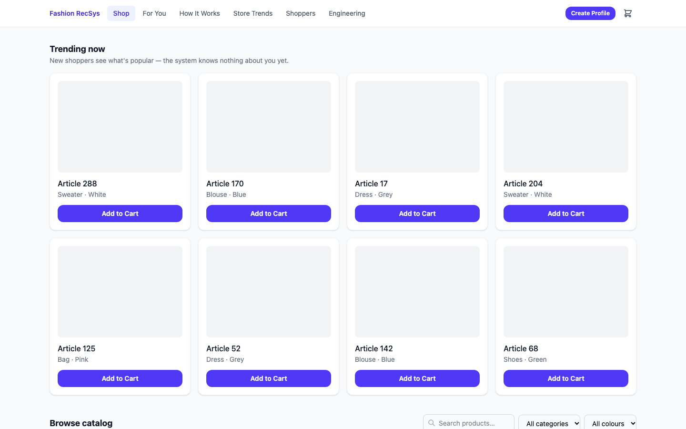
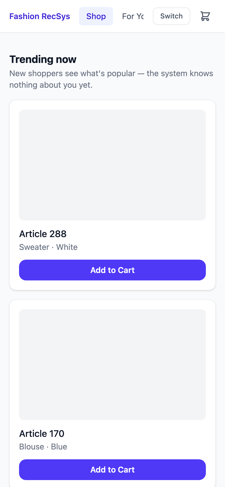
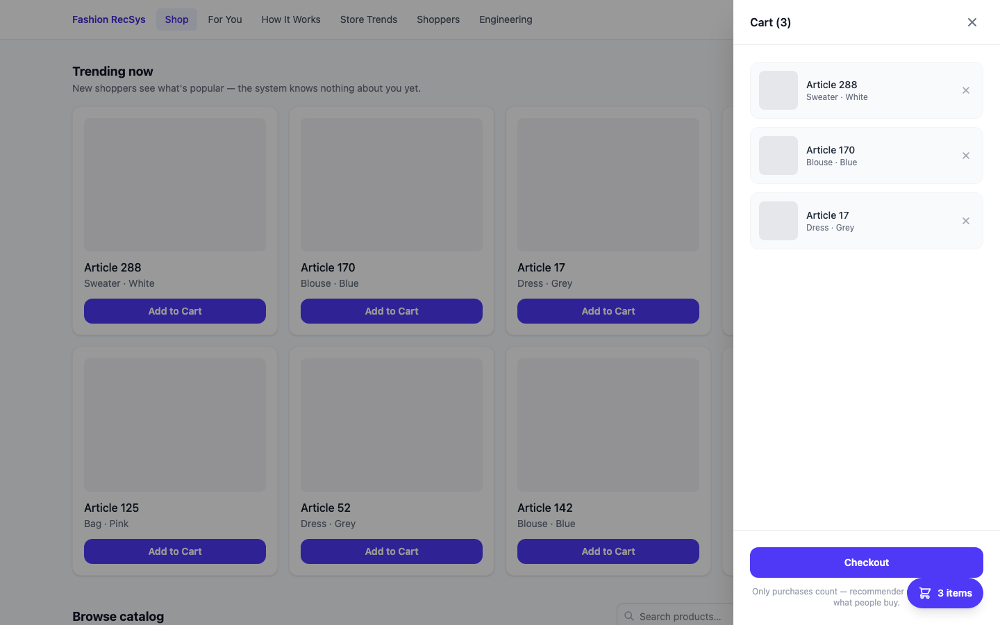
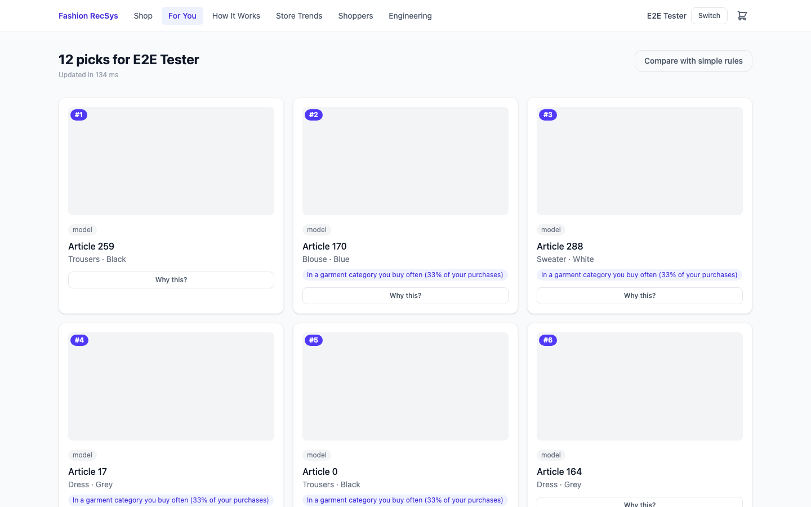
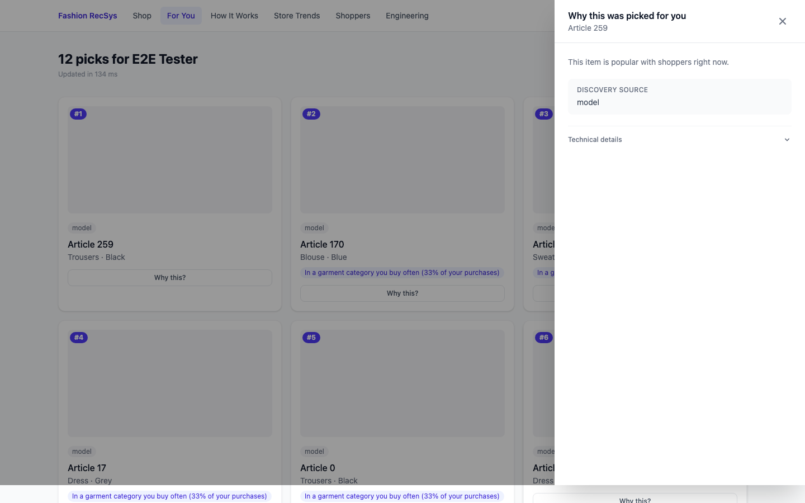
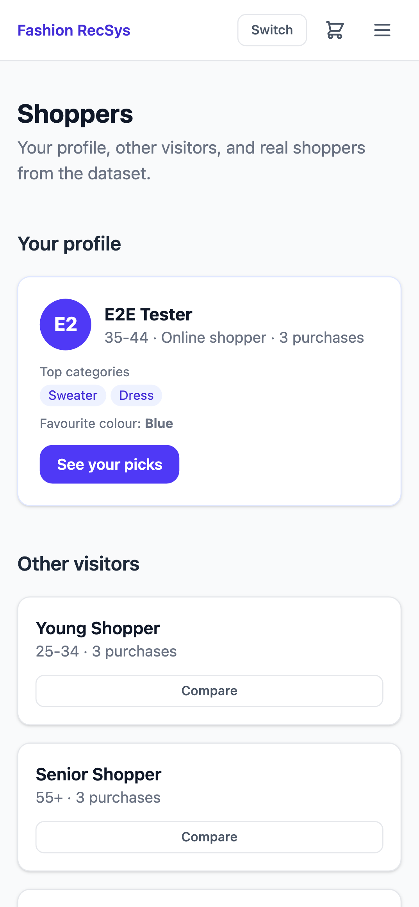

# H&M Fashion Recommendation System

[](https://github.com/Coding-Samurai110602/hm-fashion-recsys/actions/workflows/ci.yml)

End-to-end production recommender built on the H&M Kaggle dataset (31.8M transactions, 1.37M customers, 105K articles). A LightGBM LambdaRank model over 68 point-in-time features achieves **+47.6% MAP@12** on the holdout week versus the heuristic baseline — lift holds across all 21 customer segments. The system is served through a FastAPI + React app (nginx) with TreeSHAP explanations, permutation A/B testing, and a one-command Docker Compose stack.

---

## Headline Results

- **+47.6% MAP@12** on the holdout week (0.036904 vs 0.024999; 95% bootstrap CI [+0.01127, +0.01258] excludes zero)
- **Lift holds across all 21 segments** — cold-start users (+52%), 91-day-inactive users (+204%), 55+ age group (+51%)
- **56ms p50** recommendation latency (no SHAP reasons); 409ms p50 with explanations; 1ms warm cache hit

---

## Screenshot



---

## Try It

**Prerequisites:** Docker Desktop >= 4.x, the exported bundle (`artifacts/bundle_week104/`, produced by `make bundle` from the full Kaggle data), and optionally product images (`data/images/`).

```bash
# One-command start (real bundle)
docker compose up          # → http://localhost:8080

# Or use the synthetic bundle (no Kaggle data needed, 300 synthetic articles)
BUNDLE_DIR=./artifacts/bundle_synthetic docker compose up
```

**6-step walkthrough:**

1. **Create Profile** — pick a nickname, age range, and channel preference.
   

2. **Browse and shop** — explore the catalog, filter by category or colour, and add items to your cart.
   

3. **Checkout** — click the cart icon and check out with 3 or more items to seed your purchase history.
   

4. **For You** — 12 items ranked for you, each with plain-language reason chips.
   

5. **Why this?** — click any "Why this?" button to open a SHAP-driven explanation drawer.
   

6. **Shoppers** — compare profiles and reveal how the model performed on real historical shoppers.
   

---

## How It Works

**Phase 1 — Candidate generation (k=200 pool, 6 sources)**

Repurchase history, product-code variants, co-purchase graph, last-week popularity, decayed popularity, and age-segment popularity are merged into a 200-item candidate pool per customer. Recall@200 = 17.5% on validation folds. Coverage is 100% (popularity fills any gaps).

**Phase 2 — Feature engineering (68 features)**

20 candidate-source flags, 16 windowed customer statistics, 20 article trend and demographic features, 9 customer-article interaction features. All features are point-in-time safe — no future data leaks across any fold boundary.

**Phase 3 — LightGBM LambdaRank**

Trained on folds 100–102, validated on fold 103, held out on week 104. Hyperparameters tuned with Optuna (30 trials). `force_row_wise=True` gives bit-identical results across runs (SHA-256 hash verified).

**Phase 4 — Serving**

FastAPI with `ThreadPoolExecutor` and LRU cache. TreeSHAP explanations via `pred_contrib=True`. SQLite profile store. One-command Docker Compose with nginx SPA + API proxy.

```
Browser → nginx:8080 ──→ React SPA
                    └──→ /api/* → FastAPI:8000 → LightGBM ranker
                                              → SQLite (profiles)
                                              → LightGBM RecommenderState (4 GB)
```

---

## Results

| Model | MAP@12 (fold 103) | MAP@12 (holdout) | Notes |
|---|---|---|---|
| LightGBM LambdaRank | **0.035832** | **0.036904** | 68 features, LambdaRank |
| Heuristic | 0.024675 | 0.024999 | Most-recent-first repurchase |
| Baseline B (most-popular) | 0.024201 | 0.024457 | Global popularity |
| Oracle (upper bound) | 0.200527 | — | GT items ranked first in pool |

Lift: +45.21% on fold 103, **+47.6% on holdout**. Bootstrap CI (1,000 resamples) excludes zero on both folds. Lift vs Baseline B on holdout: **+50.9%**.

**Segment breakdown (holdout, Holm-corrected p_ttest < 0.05 for all 21 segments):**

| Segment | Lift |
|---|---|
| Inactive users (91+ days without purchase) | +204% |
| Cold-start (0 prior purchases) | +52% |
| 55+ age group | +51% |

---

## Engineering Quality

- **Tests:** 349 CI tests (no Kaggle data needed) + 19 real-bundle integration tests + 40 Playwright E2E tests (synthetic and real compose stack)
- **CI:** GitHub Actions: lint (ruff + mypy) → unit/API tests → Docker build + smoke → E2E on compose stack
- **Docker:** 2-image compose (API ~1.1 GB, nginx SPA 77 MB); one command: `docker compose up`
- **Reproducibility:** `force_row_wise=True` gives bit-identical results across runs (SHA-256 hash verified)

---

## Project Structure

```
src/candidates/     — 6 candidate generators (k=200 pool)
src/features/       — 68 point-in-time features
src/model/          — LightGBM LambdaRank: train, evaluate, serve
src/evaluation/     — metric suite, A/B simulation, segment analysis
src/explain/        — TreeSHAP, reason templates, faithfulness test
src/api/            — FastAPI (33 endpoints, 20 router files)
src/serving/        — bundle loader + BundleRecommender
frontend/           — React 19 + Tailwind + Recharts SPA
scripts/            — training pipeline, bundle export, CI smoke test
tests/              — 463 total backend tests
```

---

## Limitations

- Holdout covers one week (week 104); temporal generalization beyond one week is not measured. Lift was stable across validation weeks 101–104.
- Cold-start lift (+52%) comes from popularity signals only — personalization requires purchase history.
- Catalog coverage is narrower than the heuristic; the ranker concentrates on popular items.
- Segment-popular candidates contribute 0 unique items to the pool (`popularity_last_week` k=200 fills all 200 slots first); the age-bucket signal reaches scoring via the `i_age_gap` feature but does not differentiate the candidate pool.
- Kaggle data ends September 2020; the model does not generalize to post-2020 fashion trends.

---

## Data and Licence Note

The H&M dataset is subject to Kaggle competition terms and is not redistributed in this repository. To reproduce: download from [Kaggle](https://www.kaggle.com/competitions/h-and-m-personalized-fashion-recommendations/data) and place CSVs in `data/raw/`. Run `make bundle` to export the serving bundle. The synthetic bundle (`artifacts/bundle_synthetic/`) uses no real H&M data and is committed for CI.
